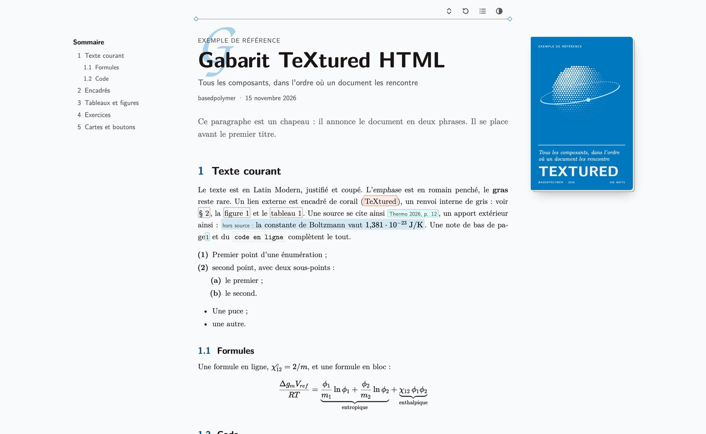
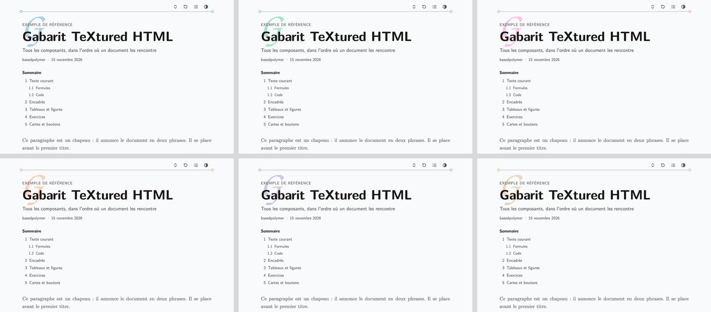
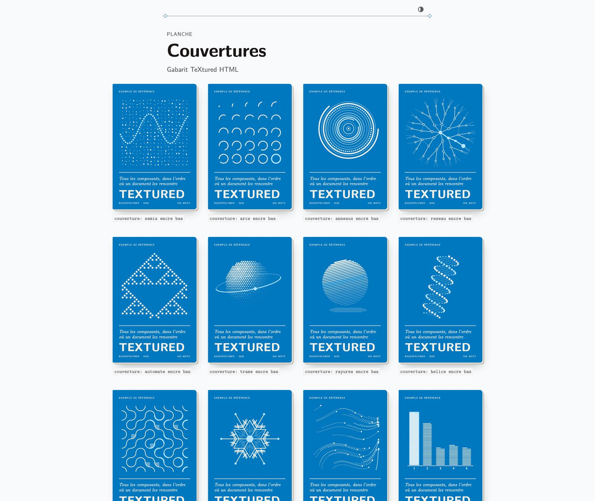
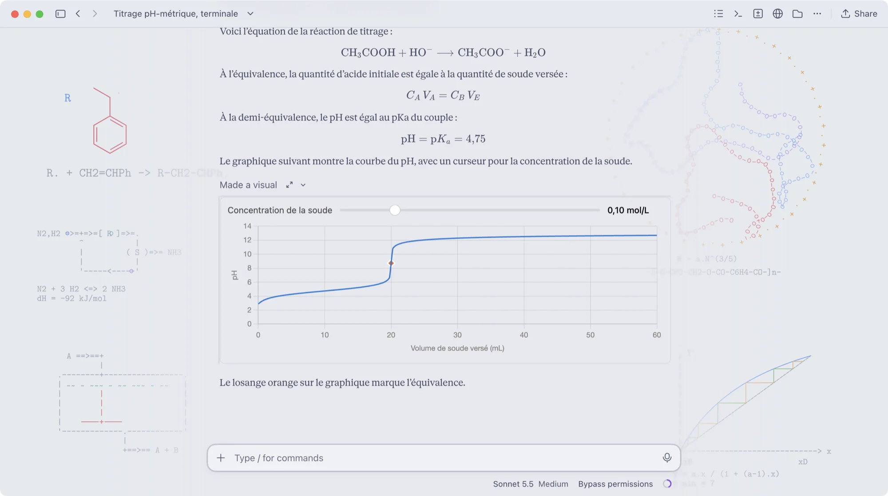
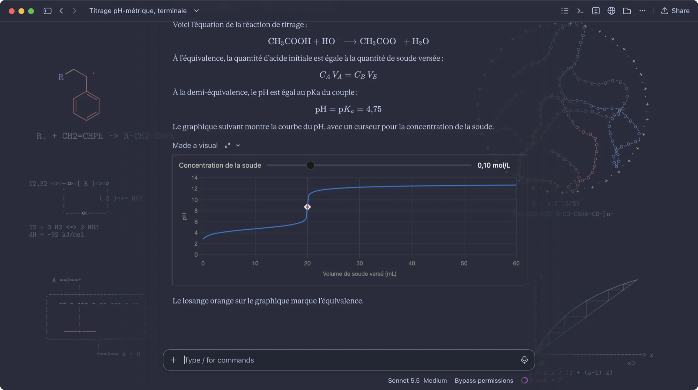

# atelier-monet

*Français : [README.md](README.md).*

The skills and tools I use with my AI agents, gathered in a Claude Code plugin marketplace.

| Tool | Kind | What it does |
|---|---|---|
| [textured](plugins/textured/skills/textured) | skill | LaTeX-style HTML documents, reports and full courses: formulas, interactive figures, revision priorities, A4 PDF, covers; live example: [basedpolymer.eu/textured](https://basedpolymer.eu/textured/en) |
| [atelier-vitrail](plugins/atelier-vitrail) | theme | Claude Code in Catppuccin colours (Latte by day, Frappé by night), over an animated ASCII background drawn afresh for each session |

The tools' instructions and interfaces are in French; Claude follows them whatever language you write in.

## textured







## atelier-vitrail





## Install

In a Claude Code session:

```
/plugin marketplace add basedpolymer/atelier-monet
/plugin install textured@atelier-monet
/plugin install atelier-vitrail@atelier-monet
```

From a shell: `claude plugin marketplace add basedpolymer/atelier-monet`, then
`claude plugin install textured@atelier-monet`. In the desktop app, where `/plugin` does not run: + next to the input
box, Plugins, Add marketplace with `basedpolymer/atelier-monet`, then Add plugin. Update with
`/plugin marketplace update atelier-monet`.

Each tool also installs without the plugin system; its README says how.

## Layout

- `plugins/<tool>/`: one plugin per tool, with its `.claude-plugin/plugin.json` and components (`skills/`, `hooks/`…),
  listed in `.claude-plugin/marketplace.json`.
- `docs/`: the READMEs' visuals, outside the plugins (not installed with them).

## Licenses

Each tool keeps its own, in its folder.
