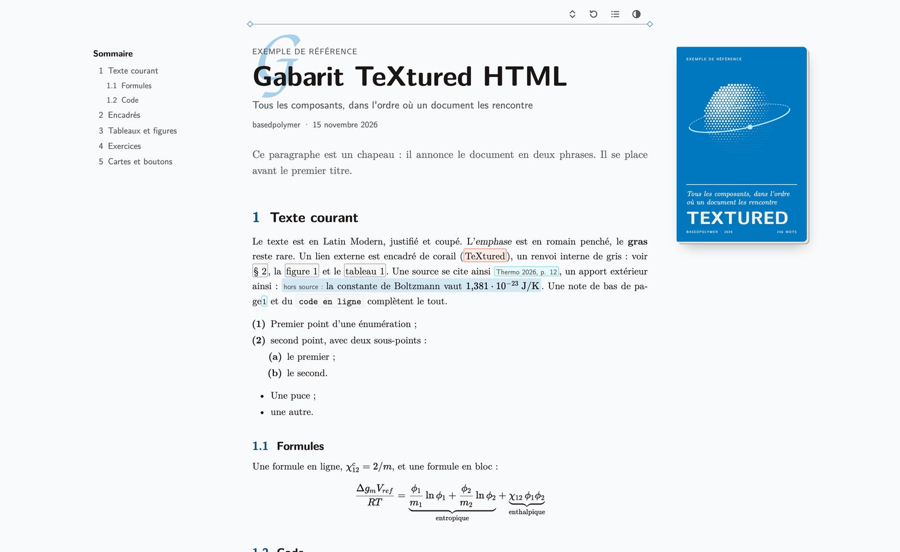
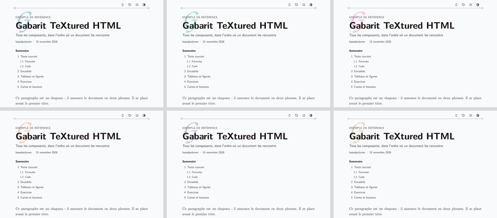
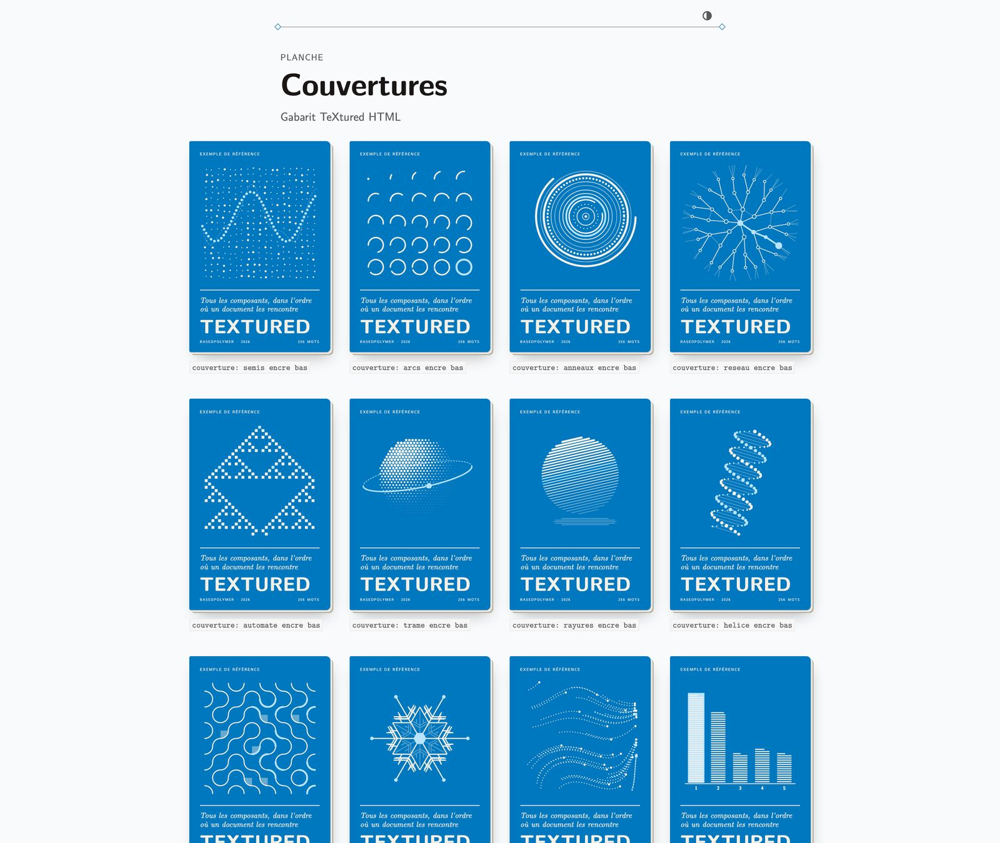
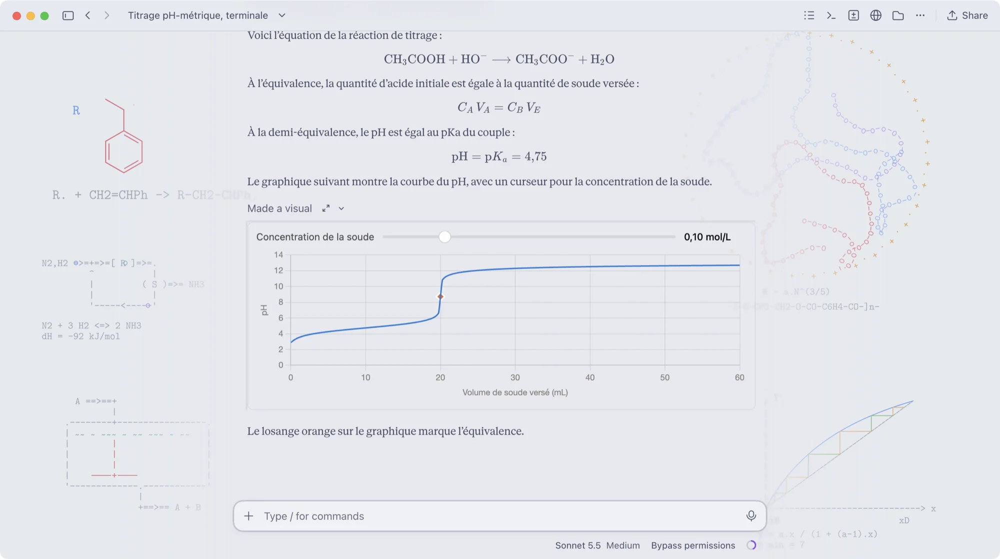
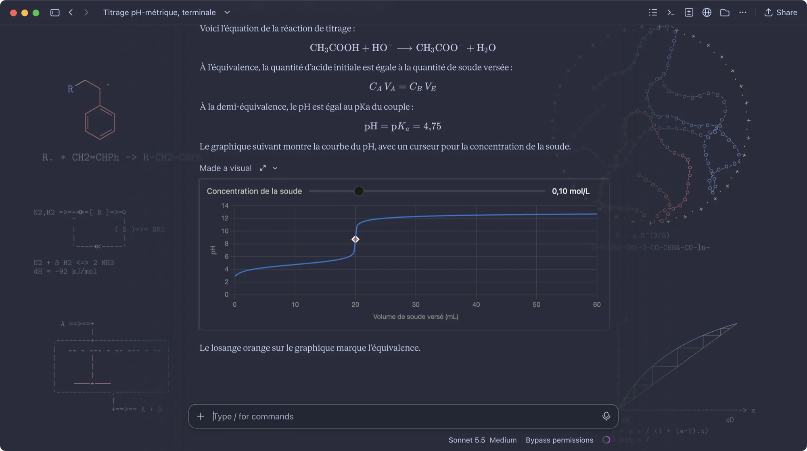

# atelier-monet

*English: [README.en.md](README.en.md).*

Les skills et outils que j'utilise avec mes agents IA, réunis en un marketplace de plugins Claude Code.

| Outil | Genre | Ce qu'il fait |
|---|---|---|
| [textured](plugins/textured/skills/textured) | skill | documents, rapports et cours complets en HTML au style LaTeX : formules, jouets interactifs, priorités de révision, PDF A4, couvertures ; exemple en ligne : [basedpolymer.eu/textured](https://basedpolymer.eu/textured) |
| [atelier-vitrail](plugins/atelier-vitrail) | thème | Claude Code aux couleurs de Catppuccin (Latte le jour, Frappé la nuit), sur un fond animé en caractères ASCII, tiré au sort à chaque session |

## textured







## atelier-vitrail





## Installation

Dans une session Claude Code :

```
/plugin marketplace add basedpolymer/atelier-monet
/plugin install textured@atelier-monet
/plugin install atelier-vitrail@atelier-monet
```

Depuis un shell : `claude plugin marketplace add basedpolymer/atelier-monet`, puis
`claude plugin install textured@atelier-monet`. Dans l'app de bureau, où `/plugin` ne s'exécute pas : + à côté de la
zone de saisie, Plugins, Add marketplace avec `basedpolymer/atelier-monet`, puis Add plugin. Mettre à jour :
`/plugin marketplace update atelier-monet`.

Chaque outil s'installe aussi sans plugin ; son README dit comment.

## Organisation

- `plugins/<outil>/` : un plugin par outil, avec son `.claude-plugin/plugin.json` et ses composants (`skills/`,
  `hooks/`…), listés dans `.claude-plugin/marketplace.json`.
- `docs/` : les visuels des README, hors des plugins (ils ne sont pas installés avec eux).
- Ajouter un outil : un dossier `plugins/<nom>/` (un skill seul va dans `plugins/<nom>/skills/<nom>/`), une entrée
  dans `marketplace.json` et dans le tableau ci-dessus, puis `claude plugin validate .`.

## Licences

Chaque outil garde la sienne, dans son dossier.
