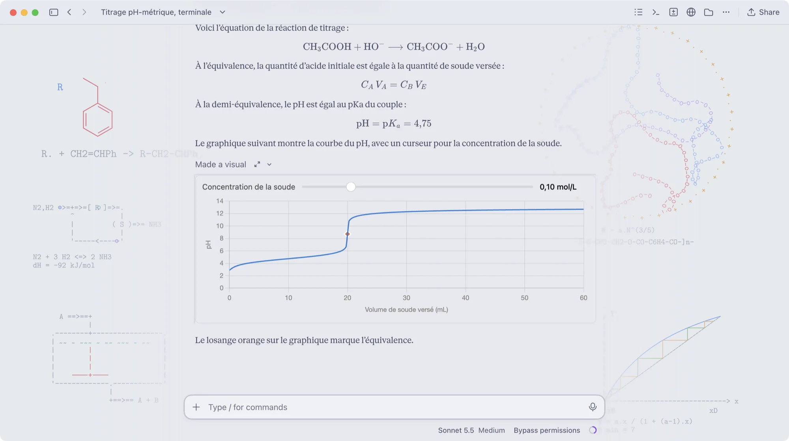
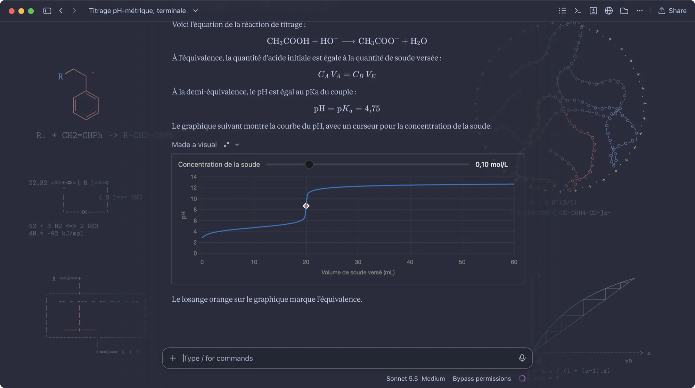
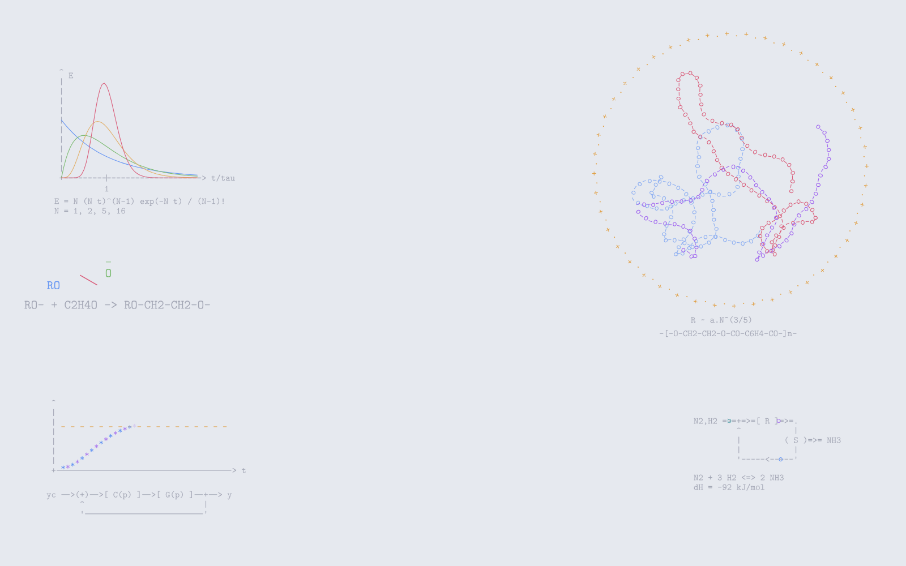
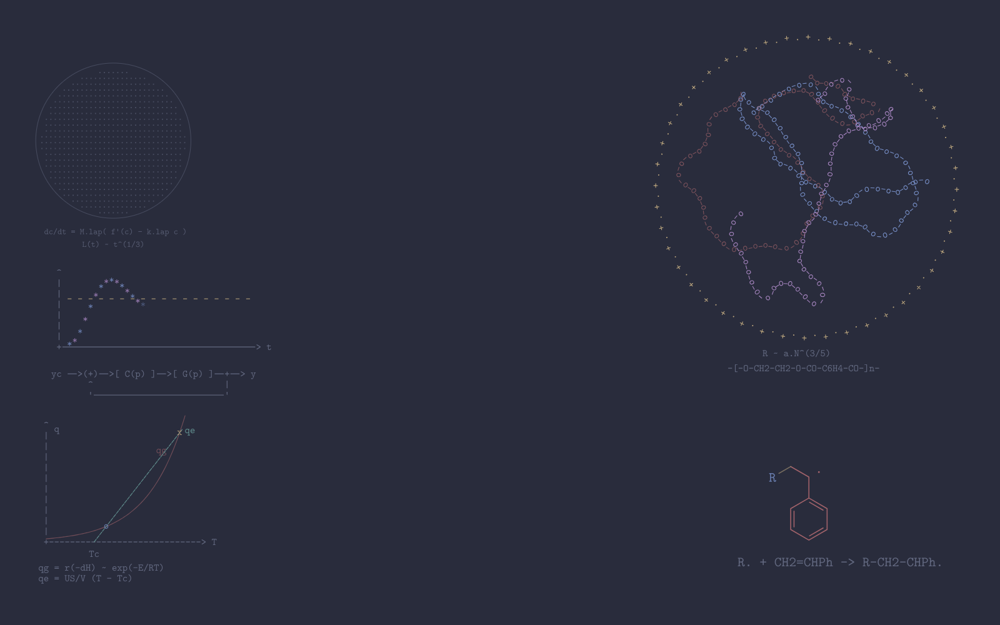

# atelier-vitrail

Thème pour Claude Code, dans l'esprit LaTeX et ASCII, aux couleurs de [Catppuccin](https://catppuccin.com) : Latte le jour, Frappé la nuit. Le fond est fait de caractères doucement animés : des pelotes de polymère, une réaction en formule topologique et des schémas de génie chimique. Chaque session a le sien.





<details>
<summary>Le fond seul</summary>





</details>

## Un fond par session

L'heure de début de la session sert de graine. Elle tire :

- la conformation des trois pelotes, toujours présentes, et les rythmes de leurs replis ;
- une réaction, toujours présente elle aussi, parmi quatre : estérification, Diels-Alder, ouverture de l'oxyde d'éthylène par un alcoolate, addition d'un radical sur le styrène. Les fragments s'approchent, les liaisons se rompent et se forment, puis tout recommence ;
- un à trois motifs parmi huit, leur place et leurs paramètres : un réacteur agité, une réponse indicielle, une décomposition spinodale (Cahn-Hilliard, simulée par `spinodale.py`), un diagramme de Semenov jusqu'à l'emballement, une distillation de McCabe et Thiele à reflux total, la distribution des temps de séjour d'une cascade de réacteurs, un plan d'expériences 2³ dont les essais s'allument dans un ordre tiré au sort, la boucle de synthèse de l'ammoniac.

## Le fond suit le travail de Claude

- Pendant un tour, la pale du réacteur tourne et des bulles montent ; la réponse indicielle se trace. Entre deux tours, ils sont au repos. Chaque session a au moins l'un des deux.
- Les pelotes s'allongent au fil des tours, et leur rayon avec elles (R ~ a.N^(3/5)) ; une compaction de la conversation les coupe en deux.
- Le mot de la ligne d'attente est un geste d'atelier ou de laboratoire (« Annealing », « Purging with nitrogen », « Casting the film »…), qui change à chaque tour.

Le fond n'est redessiné qu'au début et à la fin d'un tour ; les mouvements continus reprennent où ils en étaient.

## Comment il est fait

Le fond est un seul SVG, animé en CSS par des transformations et des changements d'opacité. Ses caractères sont des formes, pas du texte : chaque lettre est le contour d'un caractère de Latin Modern Mono (`glyphes.py` les écrit dans `hooks/scene.ts`), et les plus nombreux (`-`, `.`, `o`, `+`) sont tracés au trait. Rien ne se sélectionne, ne se copie ni ne se lit à voix haute. Il s'immobilise si le système demande moins d'animations ; sur téléphone, seuls restent les pelotes et un motif.

L'app de bureau surveille le fond et l'immobilise s'il lui coûte trop à redessiner (plus de 5,56 ms par image), s'il clignote ou s'il dépasse 131 072 caractères. Celui-ci coûte de 2 à 4 ms selon le tirage et ne dépasse pas 97 000 caractères. Dans l'app, il bouge au début de chaque tour et après chaque réponse, puis l'app finit par l'immobiliser, au bout d'une demi-minute à deux minutes ; le tour suivant le relance.

## Installation

Dans une session de terminal :

```
/plugin install atelier-vitrail --marketplace basedpolymer/atelier-monet
```

Claude Code demande d'ajouter le marketplace (répondre `y`), puis la portée : choisir « user » pour que le thème s'applique à toutes les sessions.

Depuis un shell :

```
claude plugin install atelier-vitrail --marketplace basedpolymer/atelier-monet
```

Dans l'app de bureau, où `/plugin` ne s'exécute pas : cliquer sur + à côté de la zone de saisie, puis Plugins, Add marketplace avec `basedpolymer/atelier-monet`, puis Add plugin.

## Essai depuis un dossier local

```
claude --plugin-dir /chemin/vers/atelier-vitrail
```

Ou, pour toutes les sessions, dans `~/.claude/settings.json` :

```json
"env": { "CLAUDE_CODE_PLUGIN_DIRS": "~/.claude/mods/atelier-vitrail" }
```
