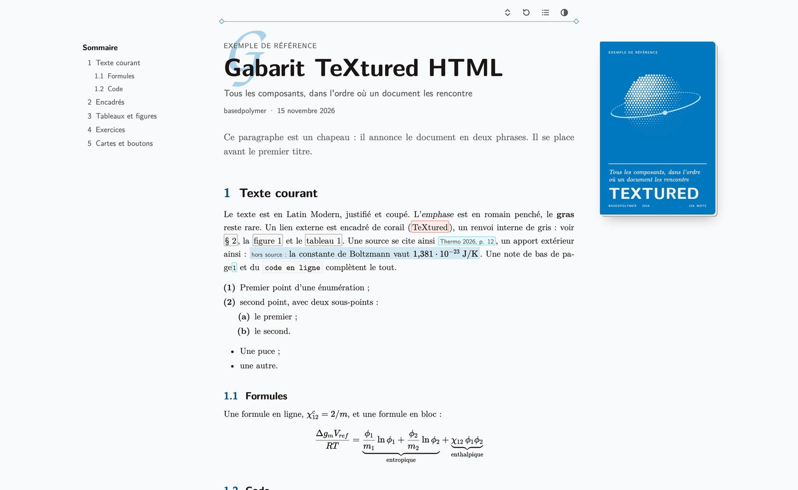
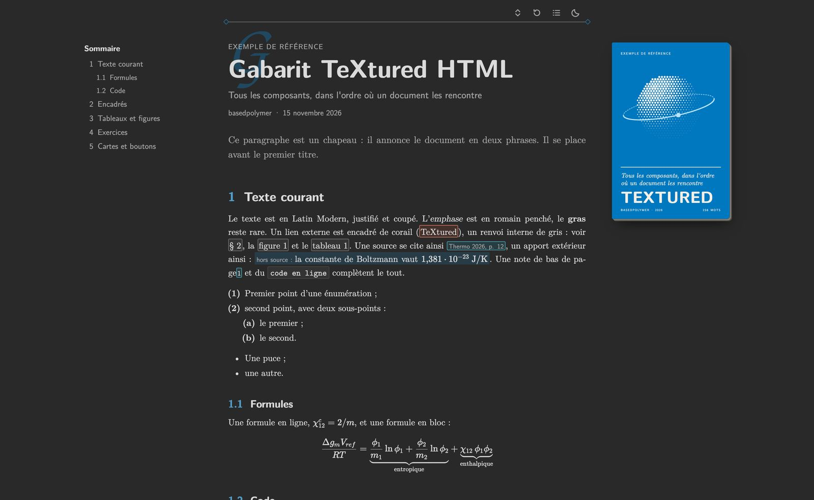
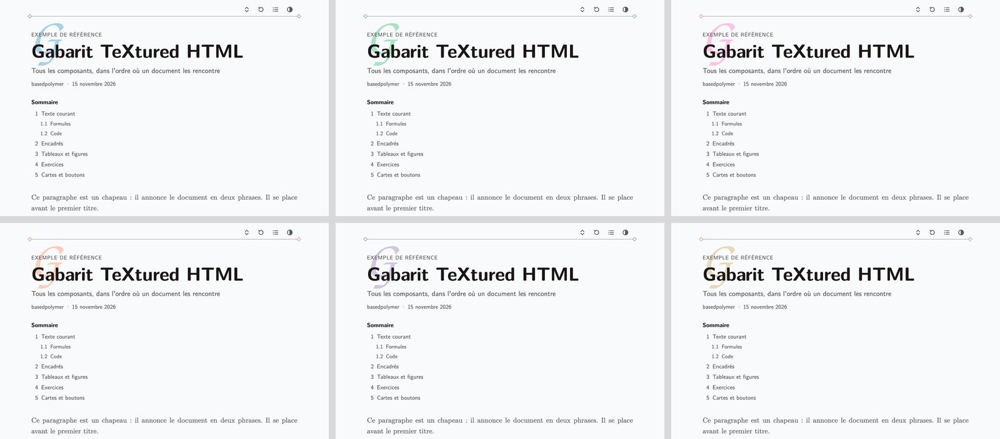
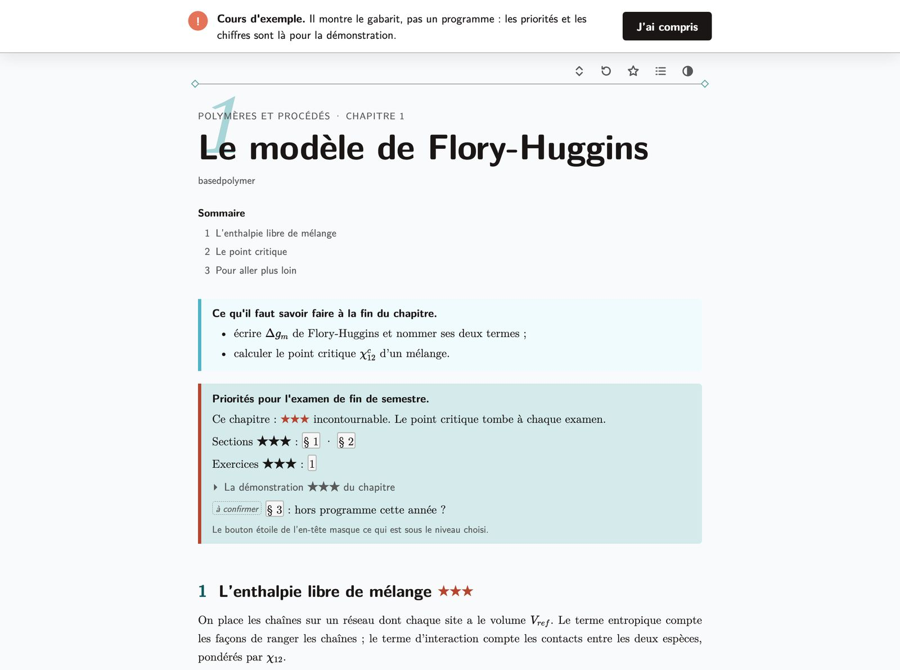
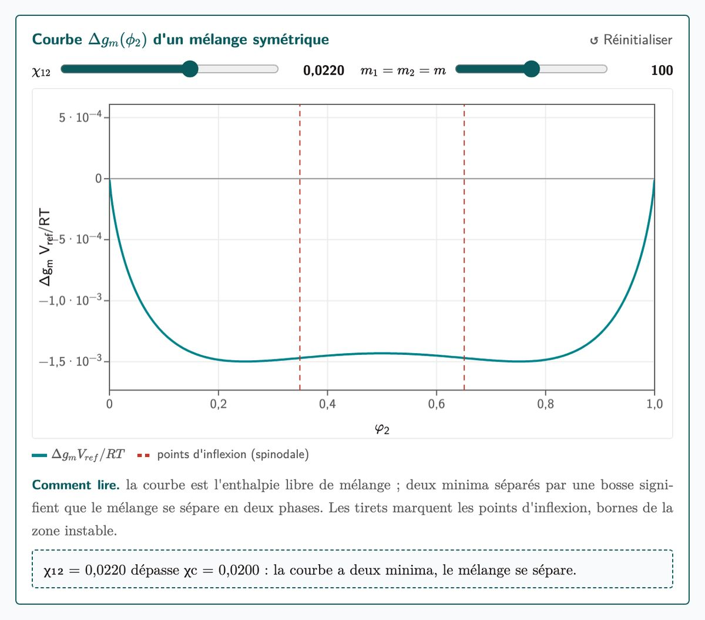
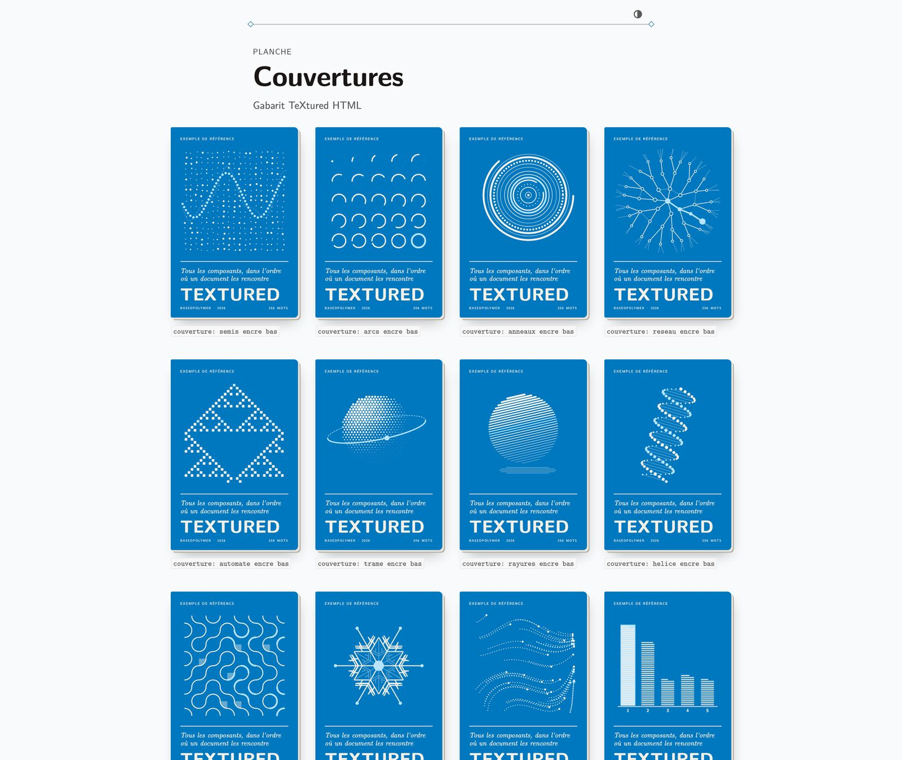
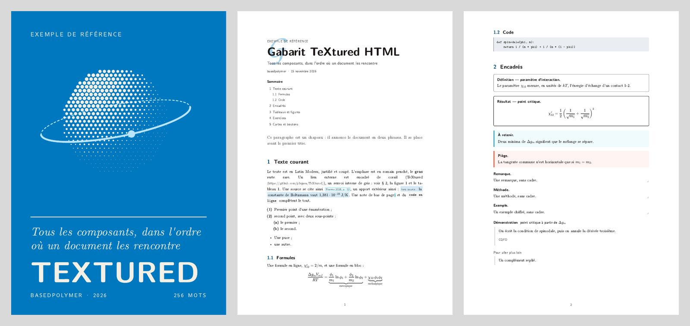

# TeXtured

*Français : [README.md](README.md) · Live example: [basedpolymer.eu/textured](https://basedpolymer.eu/textured/en)*

A Claude Code skill: a short Markdown source becomes a self-contained HTML page that looks like a LaTeX document
(Latin Modern, diamond rules, booktabs tables, boxes, pre-rendered KaTeX, light and dark themes), or a full course:
linked chapters, interactive figures ("toys"), revision priorities. One option prints an A4 PDF, another makes the
social preview image; a cover is drawn on request.





Every page has its ink, picked by Claude for the subject; the page derives its pastels from it:



A course: a priorities box at the top of each chapter, toys that follow the ink and the theme.





Generative covers, and the A4 PDF:





HTML adaptation of Jonáš Dujava's LaTeX template [TeXtured](https://github.com/jdujava/TeXtured), not affiliated with
him. The skill's instructions and messages are in French; Claude follows them whatever language you write in, and
`lang: en` gives a page an English interface.

## Install

Requirements: Python 3.10+, [pandoc](https://pandoc.org), [node](https://nodejs.org); for `--pdf` and `--apercu`,
Google Chrome, otherwise Microsoft Edge (built into Windows). macOS: `brew install pandoc node`; Windows:
`winget install JohnMacFarlane.Pandoc OpenJS.NodeJS.LTS`.

As a plugin, in a Claude Code session:

```
/plugin marketplace add basedpolymer/atelier-monet
/plugin install textured@atelier-monet
```

Or by hand, as a personal skill (macOS, Linux):

```bash
git clone https://github.com/basedpolymer/atelier-monet.git
ln -s "$PWD/atelier-monet/plugins/textured/skills/textured" ~/.claude/skills/textured
```

On Windows, copy `plugins/textured/skills/textured` to `%USERPROFILE%\.claude\skills\textured`. Then ask Claude for
"a TeXtured report on …", "a full TeXtured course on …", or type `/textured`.

## Use it by hand

```bash
python3 textured.py doc.md --ouvrir      # doc.html, opened in the browser (Windows: python)
python3 textured.py doc.md --pdf         # and doc.pdf (A4)
python3 textured.py doc.md --apercu      # and doc.preview.jpg (1200 × 630, og:image)
python3 textured.py course/              # a whole course: index.md and its chapters
python3 textured.py doc.md --couverture  # with a cover (couverture.md)
python3 textured.py doc.md --planche     # doc.couvertures.html: the cover in every pattern
python3 textured.py --exporter FOLDER    # styles and fonts for a website (--assets mode), KaTeX fonts as files
```

`TEXTURED_NAVIGATEUR=/path/to/chrome` picks the browser for `--pdf` and `--apercu`. Examples: `exemple.md` (every
component), `exemples/cours/` (a two-chapter course with two toys).

## Make it yours

`publier.md`, if present in the skill folder, tells Claude where and how to publish a "shareable version" (website,
translation…). Git ignores it: write your own.

## Change the template

`textured.py` assembles and checks, `couverture.py` lays out covers, `motifs.py` holds the patterns and their
catalogue, `icone.py` the favicon marks; `polices.py` (fontTools) splits each Latin Modern font into a base (Latin-1,
French punctuation) and a complement loaded on demand (`unicode-range`), and rewrites the `polices` block of `textured.css`; `assets/*.css` and `assets/textured.js` are split
into `/*@ name | pattern */` blocks, each embedded only when its pattern appears in the page. After a change:
`python3 tests/verifier.py --pdf` (also runs on GitHub). `SKILL.md` is read by Claude every time: keep it short and put
details in the files read on demand (`cours.md`, `exercices.md`, `jouets.md`, `couverture.md`).

## Licenses

The skill's code and documentation: MIT (`LICENSE`). KaTeX (MIT), LaTeX.css (MIT), TeXtured (CC0) and the Latin Modern
and TeX Gyre Chorus fonts (GUST Font License) keep theirs: `LICENCES-TIERCES.md`.
