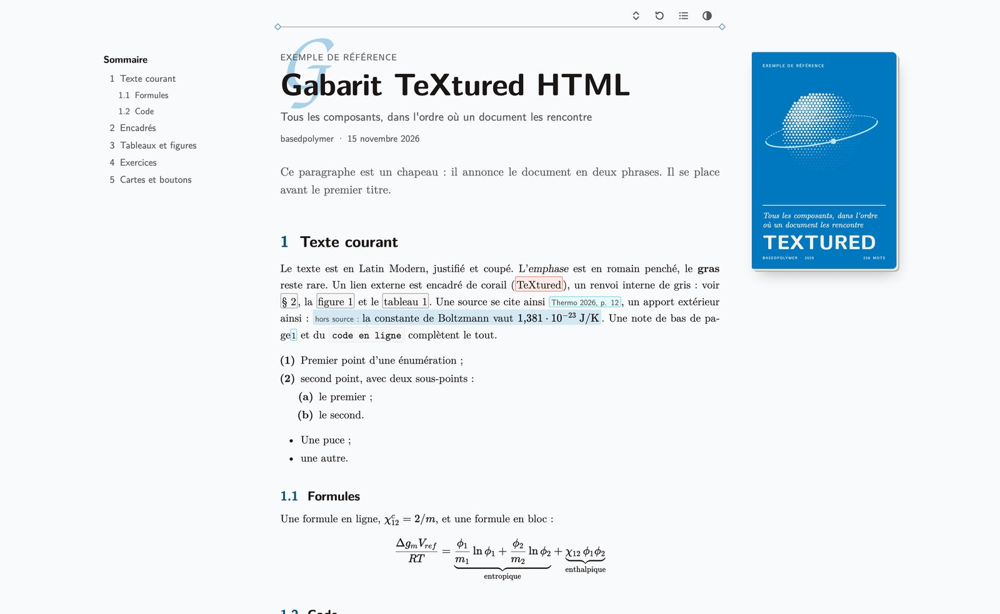
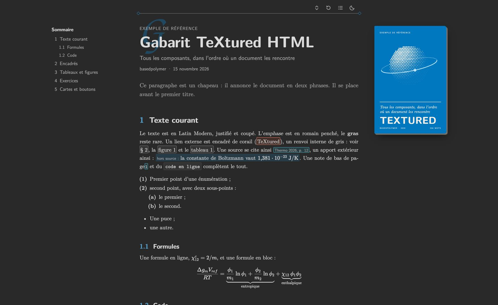
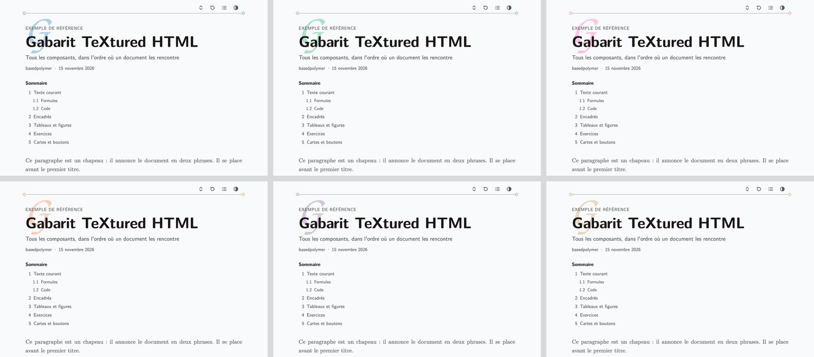
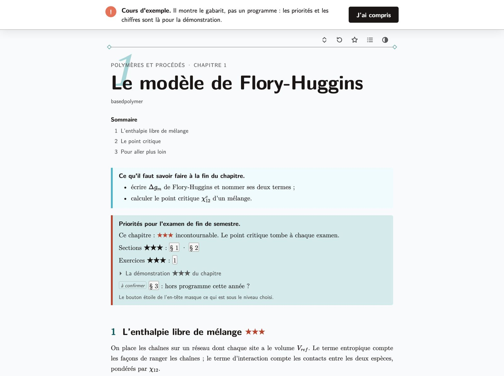
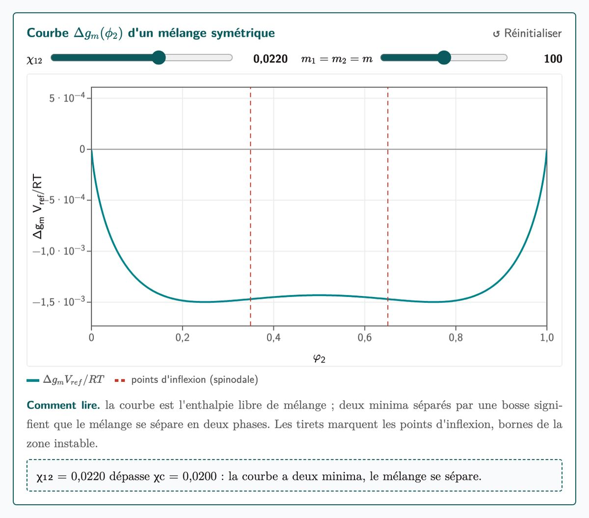
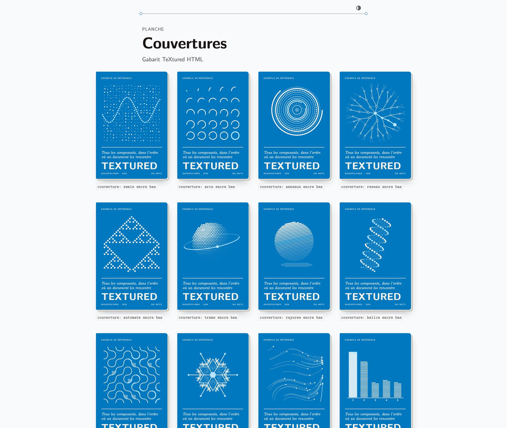
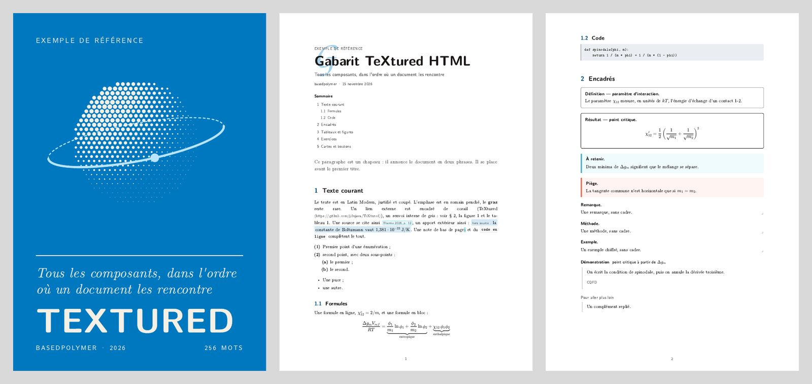

# TeXtured

*English: [README.en.md](README.en.md) · Exemple en ligne : [basedpolymer.eu/textured](https://basedpolymer.eu/textured)*

Skill Claude Code : une source Markdown courte devient une page HTML autonome au style d'un document LaTeX (Latin
Modern, filets à losanges, tableaux booktabs, encadrés, formules KaTeX pré-rendues, thème clair et sombre), ou un cours
complet : chapitres reliés, jouets interactifs, priorités de révision. Une option en tire un PDF A4, une autre l'image
de partage ; une couverture se dessine sur demande.





Chaque page a son encre, choisie par Claude d'après le sujet ; la page en tire ses pastels :



Un cours : encadré des priorités en tête de chapitre, jouets interactifs qui suivent l'encre et le thème.





Couvertures génératives, et PDF A4 :





Adaptation HTML du gabarit LaTeX [TeXtured](https://github.com/jdujava/TeXtured) de Jonáš Dujava, sans lien avec son
auteur.

## Installer

Dépendances : Python 3.10 ou plus, [pandoc](https://pandoc.org), [node](https://nodejs.org) ; pour `--pdf` et
`--apercu`, Google Chrome, à défaut Microsoft Edge (présent sous Windows). macOS : `brew install pandoc node` ;
Windows : `winget install JohnMacFarlane.Pandoc OpenJS.NodeJS.LTS`.

En plugin, dans une session Claude Code :

```
/plugin marketplace add basedpolymer/atelier-monet
/plugin install textured@atelier-monet
```

Ou à la main, en skill personnel (macOS, Linux) :

```bash
git clone https://github.com/basedpolymer/atelier-monet.git
ln -s "$PWD/atelier-monet/plugins/textured/skills/textured" ~/.claude/skills/textured
```

Sous Windows, copier le dossier `plugins/textured/skills/textured` dans `%USERPROFILE%\.claude\skills\textured`.
Ensuite, demander à Claude « un rapport en TeXtured sur … », « un cours complet en TeXtured sur … », ou `/textured`.

## Utiliser à la main

```bash
python3 textured.py doc.md --ouvrir      # doc.html, ouvert dans le navigateur (Windows : python)
python3 textured.py doc.md --pdf         # et doc.pdf (A4)
python3 textured.py doc.md --apercu      # et doc.preview.jpg (1200 × 630, og:image)
python3 textured.py cours/               # un cours entier : index.md et ses chapitres
python3 textured.py doc.md --couverture  # avec une couverture (couverture.md)
python3 textured.py doc.md --planche     # doc.couvertures.html : la couverture dans chaque motif
python3 textured.py --exporter DOSSIER   # styles et polices pour un site (mode --assets), KaTeX en fichiers à part
```

`TEXTURED_NAVIGATEUR=/chemin/vers/chrome` impose le navigateur de `--pdf` et `--apercu`. Exemples : `exemple.md` (tous
les composants), `exemples/cours/` (un cours de deux chapitres et deux jouets).

## Personnaliser

`publier.md`, s'il existe dans le dossier du skill, dit à Claude où et comment publier une « version à partager »
(site, traduction…). Git l'ignore : chacun écrit le sien.

## Modifier le gabarit

- `textured.py` : assemblage et contrôle ; `couverture.py` : couvertures (palette, mise en page, planche) ;
  `motifs.py` : motifs et catalogue par domaine ; `icone.py` : marques des favicons ; `polices.py` (fontTools) : coupe
  chaque police Latin Modern en une base (latin-1, ponctuation du français) et un complément chargé à la demande
  (`unicode-range`), et réécrit le bloc `polices` de `textured.css`.
- `assets/textured.css`, `assets/couverture.css`, `assets/textured.js` : découpés en blocs `/*@ nom | motif */` ; un bloc
  n'est embarqué que si son motif apparaît dans la page.
- Après un changement : `python3 tests/verifier.py --pdf` (construit l'exemple, le cours d'exemple et une couverture,
  exige des bilans propres et des jouets sans erreur ; tourne aussi sur GitHub), puis regarder les pages en clair, en
  sombre, à largeur de téléphone et sur papier.
- `SKILL.md` est lu par Claude à chaque usage : le garder court ; le détail va dans les fichiers lus à la demande
  (`cours.md`, `exercices.md`, `jouets.md`, `couverture.md`).

## Licences

Code et documentation du skill : MIT (`LICENSE`). KaTeX (MIT), LaTeX.css (MIT), TeXtured (CC0) et les polices Latin
Modern et TeX Gyre Chorus (GUST Font License) gardent les leurs : `LICENCES-TIERCES.md`.
